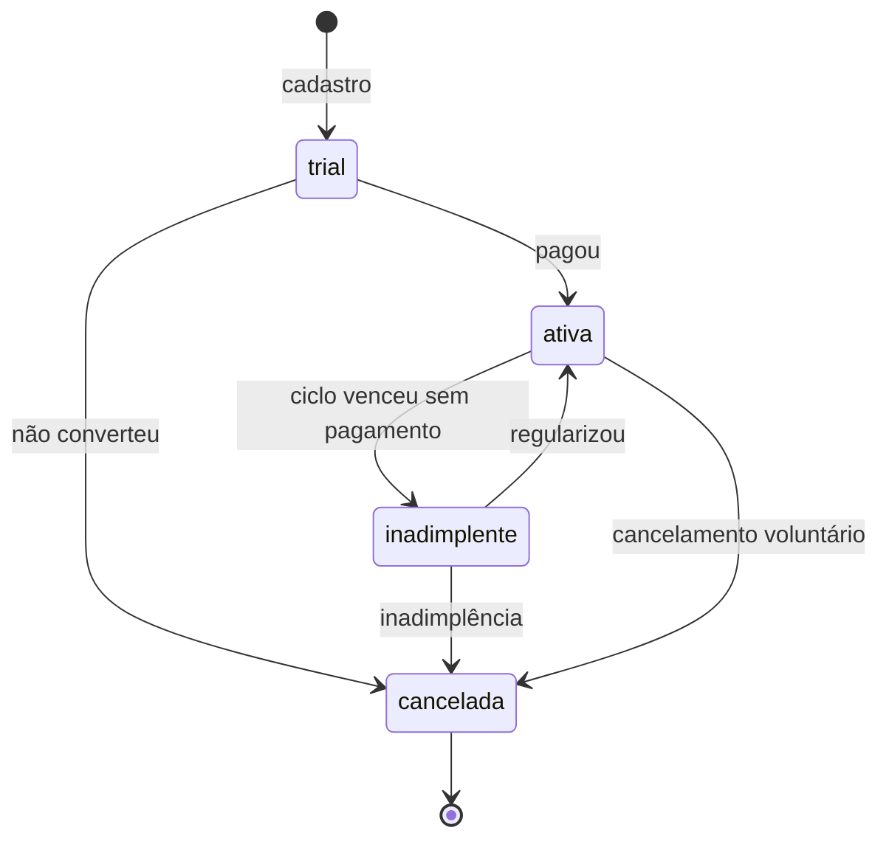

# Caso de negócio — Pauta Digital

> Empresa fictícia criada para este laboratório. Qualquer semelhança com empresas reais é coincidência.

O caso existe para dar contexto ao banco: as tabelas, as constraints e as migrations representam regras de um negócio, e não exemplos soltos. O foco do projeto continua sendo Docker, PostgreSQL e Flyway.

## A empresa

A **Pauta Digital** é uma plataforma de assinatura de conteúdo. Com uma assinatura, o leitor acessa um catálogo de **publicações digitais**: revistas e newsletters sobre economia, tecnologia, cultura e esportes.

O banco guarda planos, publicações, assinantes, assinaturas e cupons de desconto.

## Planos

| Plano | Periodicidade | Preço | Publicações | Perfis |
|-------|---------------|-------|-------------|--------|
| Essencial | Mensal | R$ 19,90 | Só as newsletters | 1 |
| Completo | Mensal | R$ 39,90 | Todas | 1 |
| Completo Anual | Anual | R$ 399,00 | Todas | 1 |
| Família | Mensal | R$ 59,90 | Todas | até 4 |

Os planos, as 8 publicações (uma revista e uma newsletter por categoria) e a ligação entre eles são carregados pela migration V1. Os preços são guardados em **centavos** (`integer`), nunca em `float`.

## Status de uma assinatura

O banco guarda os quatro status (`trial`, `ativa`, `inadimplente`, `cancelada`) e os motivos de cancelamento. As **transições não são automáticas**: não há cobrança nem rotina que mude o status. O diagrama mostra o significado de cada status, e os dados de exemplo são gerados de forma coerente com ele.

## Regras garantidas pelo banco

Estas regras são impostas pelo próprio PostgreSQL. Um dado que as viole é recusado, venha de onde vier.

| Regra | Como o banco garante | Migration |
|-------|----------------------|-----------|
| E-mail único, sem diferenciar maiúsculas de minúsculas | `citext` + `UNIQUE` em `assinantes.email` | V1 |
| UF válida (duas letras maiúsculas) | `CHECK (uf ~ '^[A-Z]{2}$')` | V1 |
| Preços e valores não negativos | `CHECK` nas colunas de valor | V1 |
| Uma assinatura em andamento por assinante (`trial`, `ativa` ou `inadimplente`) | Índice único parcial `WHERE status <> 'cancelada'` | V1 |
| Assinatura cancelada sempre com data e motivo, e só ela | `CHECK` combinando `status`, `cancelada_em` e `motivo` | V1 |
| Código de cupom único, sem diferenciar maiúsculas de minúsculas | `citext` + `UNIQUE` em `cupons.codigo` | V2 |
| Desconto percentual de no máximo 100% | `CHECK` nomeada `ck_cupons_percentual_max` | V2 |
| Assinatura só aponta para cupom existente | Chave estrangeira `assinaturas.cupom_id` | V2 |

## Cupons

Adicionados pela V2, num banco que já tinha dados. Um cupom tem:

- **Tipo:** `percentual` ou `valor_fixo` (em centavos).
- **Ciclos:** quantas cobranças recebem o desconto.
- **Validade** e **limite de usos**, opcionais.

Cupons iniciais: `BEMVINDO10` (10%), `ANUAL50` (R$ 50,00) e `BLACKFRIDAY` (50% por 3 ciclos, válido até 30/11/2026, até 1.000 usos).

Validade, limite de usos e ciclos são **registrados**, mas não aplicados automaticamente: não há rotina de cobrança que os consulte.

## Dados de exemplo

O script `scripts/dados_exemplo.sql` gera, com `generate_series`, **500 assinantes** com uma assinatura cada, criados ao longo dos últimos dois anos:

| Status | Como é gerado |
|--------|---------------|
| `trial` | Só quem entrou nos últimos 7 dias; período de 7 dias |
| `ativa` | Cerca de 75% dos demais; ciclo atual ainda vigente |
| `inadimplente` | Cerca de 10%; ciclo vencido |
| `cancelada` | Cerca de 15%; com data e motivo; período de 30 ou 365 dias, conforme o plano |

O script não é migration: roda sob demanda e começa limpando as tabelas. Como usar: seção **Dados de exemplo** do [README](../README.md#dados-de-exemplo).

## Fora do escopo

A tabela `historico_assinaturas` existe desde a V1, mas nenhuma rotina a preenche. Cobrança, faturas, auditoria, controle de acesso por área e consultas analíticas ficaram fora do projeto, que se concentra na infraestrutura do banco.
