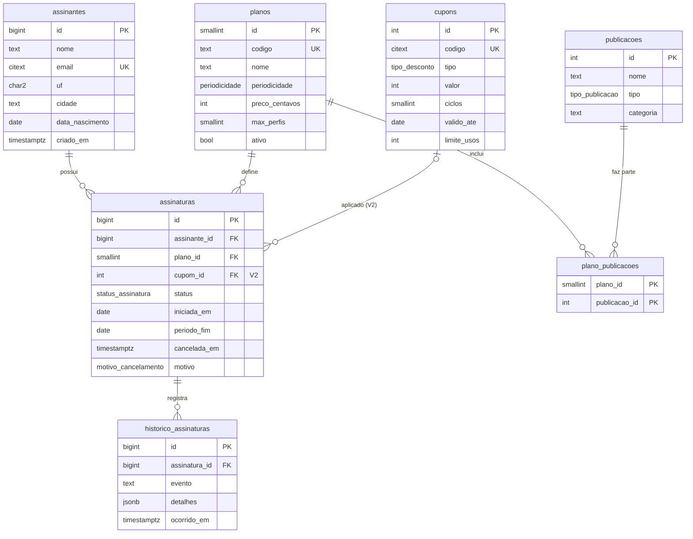

# Modelo de dados

O schema é criado e evoluído pelas migrations do Flyway, em `migrations/`. A migration que introduz cada parte está indicada.

## Diagrama

## Tipos enumerados

| Tipo | Valores | Migration |
|------|---------|-----------|
| `periodicidade` | `mensal`, `anual` | V1 |
| `tipo_publicacao` | `revista`, `newsletter` | V1 |
| `status_assinatura` | `trial`, `ativa`, `inadimplente`, `cancelada` | V1 |
| `motivo_cancelamento` | `preco`, `conteudo`, `pouco_uso`, `inadimplencia`, `trial_nao_convertido`, `outro` | V1 |
| `tipo_desconto` | `percentual`, `valor_fixo` | V2 |

## Restrições importantes

| Regra de negócio | Como o banco garante | Migration |
|------------------|----------------------|-----------|
| E-mail único, sem diferenciar maiúsculas de minúsculas | Tipo `citext` (extensão) + `UNIQUE` | V1 |
| Uma assinatura em andamento por assinante | Índice único **parcial**: `UNIQUE (assinante_id) WHERE status <> 'cancelada'` | V1 |
| Data e motivo de cancelamento existem se, e somente se, a assinatura está cancelada | `CHECK ((status = 'cancelada') = (cancelada_em IS NOT NULL) AND (status = 'cancelada') = (motivo IS NOT NULL))` | V1 |
| Preço não negativo | `CHECK (preco_centavos >= 0)` | V1 |
| Todo plano tem ao menos 1 perfil | `CHECK (max_perfis >= 1)` | V1 |
| UF no formato de duas letras maiúsculas | `CHECK (uf ~ '^[A-Z]{2}$')` | V1 |
| Código de plano único | `UNIQUE (codigo)` | V1 |
| Código de cupom único, sem diferenciar maiúsculas de minúsculas | Tipo `citext` + `UNIQUE` | V2 |
| Desconto percentual de no máximo 100% | `CONSTRAINT ck_cupons_percentual_max CHECK (tipo <> 'percentual' OR valor <= 100)` | V2 |
| Valor do cupom positivo, ao menos 1 ciclo, limite de usos positivo | `CHECK (valor > 0)`, `CHECK (ciclos >= 1)`, `CHECK (limite_usos > 0)` | V2 |
| Assinatura só aponta para cupom existente | Chave estrangeira `cupom_id REFERENCES cupons (id)`, aceitando `NULL` (sem cupom) | V2 |

## Índices

Além dos índices que o Postgres cria sozinho para `PRIMARY KEY` e `UNIQUE`:

| Índice | Tabela | Para quê | Migration |
|--------|--------|----------|-----------|
| `uq_assinaturas_ativa_por_assinante` | `assinaturas (assinante_id) WHERE status <> 'cancelada'` | Garante uma assinatura em andamento por assinante | V1 |
| `ix_assinaturas_cupom_id` | `assinaturas (cupom_id)` | O Postgres não indexa chaves estrangeiras automaticamente; evita ler a tabela inteira para achar as assinaturas de um cupom | V2 |

## Dados fixos

Carregados pelas migrations, porque fazem parte do negócio e precisam existir em qualquer banco:

- **4 planos:** Essencial, Completo, Completo Anual e Família (preços em centavos, ver [caso de negócio](caso-de-negocio.md)).
- **8 publicações:** uma revista e uma newsletter por categoria (economia, tecnologia, cultura e esportes).
- **28 ligações plano × publicação:** o Essencial inclui só as newsletters; os demais incluem todas.
- **3 cupons** (V2): `BEMVINDO10` (10%), `ANUAL50` (R$ 50,00) e `BLACKFRIDAY` (50% por 3 ciclos, até 30/11/2026, até 1.000 usos).

Os assinantes e as assinaturas **não** são dados fixos: vêm do script `scripts/dados_exemplo.sql`, executado sob demanda.

## Evolução por migrations

| Versão | Arquivo | Conteúdo | Status |
|--------|---------|----------|--------|
| V1 | `V1__schema_inicial.sql` | Extensão `citext`, ENUMs, as 6 tabelas, constraints, índice parcial e carga dos dados fixos | ✅ Aplicada |
| V2 | `V2__cupons.sql` | ENUM `tipo_desconto`, tabela `cupons`, coluna `cupom_id` e índice em `assinaturas` e carga dos cupons, aplicada num banco **com dados**, sem perdê-los | ✅ Aplicada |

Regra de ouro: **migration aplicada não se edita**. Correções entram como uma nova versão.

> A tabela `historico_assinaturas` existe desde o V1, mas não há trigger que a preencha: automatizar o histórico ficou fora do escopo do projeto.
